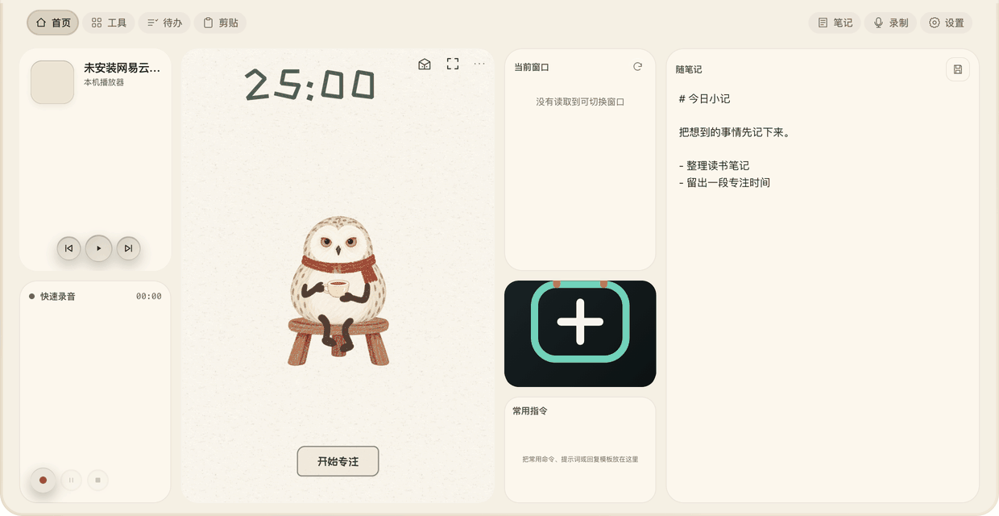
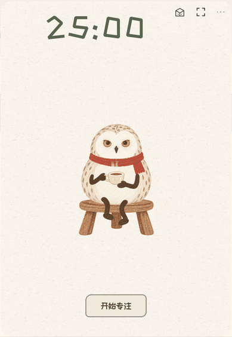

# IRiXi Toolbox · macOS Dynamic Island productivity toolbox

[简体中文](README.md) · [English](README.en.md)

Screenshot OCR, translation, clipboard history, tasks, notes and an owl Pomodoro companion, together at the top of your Mac screen. Expand the workbench when you need it, then collapse it to get back to work.

Created by [IRiXi](https://github.com/Irixil). Official repository: [Irixil/IRiXi-Toolbox](https://github.com/Irixil/IRiXi-Toolbox).

[Features](#features) · [Getting started](#getting-started) · [Build from source](#build-from-source) · [Report an issue](https://github.com/Irixil/IRiXi-Toolbox/issues)



[Static preview](docs/media/overview.png) · [How the demo was made](docs/demo-provenance.md)

> Source code is available. There is currently no public, ready-to-install signed release. The demo uses separate sample data, not private notes or focus records. The app's interface is primarily Simplified Chinese; this page is an English introduction, not a claim of an English UI.

## Features

| Tool | What it does |
| --- | --- |
| Owl Pomodoro timer | Set one task, focus, pause or start the next round. Collect decorations and arrange the owl's room. |
| Screenshot and OCR | Capture a region, window or full screen; annotate, copy, save or pin an image. Text recognition uses Apple Vision. |
| Translation | Input, image and selected-text translation through Apple Translation, with optional online Codex explanations. |
| Clipboard history | Search text, links and images; favorite and copy items. History is off until you enable it. |
| Tasks and notes | Four task categories, deadlines and reminders; quick notes, saved notes and reusable commands. |
| Recording | Microphone recording, playback and saved transcripts; optional online transcription with your own API configuration. |
| Music and mirror | NetEase Cloud Music artwork, synchronized lyrics and playback controls; an optional camera preview. |

The cream-colored workbench has resizable and rearrangeable widgets. Hide tools you do not use in Settings.

### An owl companion while you focus



Save the next focus and break durations without changing the current round. Start a new round even when the previous one is unfinished; only actual focused time is retained. Try decorations before saving a layout. The test-all-items mode is separate from normal collections and does not grant permanent rewards.

Want only the companion timer? See [IRiXi Owl Focus](https://github.com/Irixil/irixi-owl-focus). The standalone timer and the toolbox use separate saves and do not automatically synchronize.

## Getting started

The current build target is an Apple Silicon Mac running macOS 13 or later. Apple Translation features require macOS 15 or later. Other platforms have not been verified.

After starting the app, click the top-of-screen entry to expand it. Use the tabs to open tools, tasks, clipboard, notes or recording. Press Escape or click another app to collapse it. Settings contains shortcuts, widget visibility and the local data-folder shortcut.

Start with three local actions: add a task, save a note, then begin one focus session. None needs a model API. Enable clipboard history separately if wanted.

### Permissions and connections

- Screen Recording: screenshots, OCR, image translation and current-window information.
- Accessibility and Automation: selected-text translation, window switching, paste-back and some music controls.
- Microphone and Camera: recording and the optional mirror preview, when used.

Grant permissions to the exact signed app you intend to use. A complete native-module build is required; running only the renderer is not enough to test these features.

NetEase Cloud Music must be installed and running for its music card. Lyrics follow playback; there is no draggable seek bar or click-to-seek lyrics.

## Local data and privacy

Tasks, notes, clipboard history, recordings and focus saves stay in local application storage. Clipboard history and foreground-app activity recording are opt-in. The toolbox's embedded focus timer and the standalone app have different saves.

Screenshot OCR and Apple Translation run locally; initial translation use may require downloading language packs. Optional transcription sends audio to the configured provider. Optional model-based naming or grouping sends the relevant text to the configured model. Codex explanations send the supplied text, question and recent follow-ups to OpenAI. Music artwork and lyrics may also use the network.

This is not a claim that every feature works offline. API credentials use macOS secure storage and are not included in the repository.

## Build from source

Use Node.js 22.12 or later, Xcode 26 or later, and a stable signing identity available on your Mac. Older Xcode versions have not been verified.

```sh
git clone https://github.com/Irixil/IRiXi-Toolbox.git
cd IRiXi-Toolbox
./scripts/prepare.sh
cd app
npm test
npm run pack
```

`prepare.sh` assembles the native framework and bridge. If Node headers cannot be found, set `IRIXI_NODE_HEADERS` to the appropriate header directory. Packaged output is written to `app/dist.noindex/`.

Packaging refuses to produce a permission-sensitive release without a stable signing identity. `IRIXI_CODESIGN_IDENTITY` can select your own existing identity. A local signature is not equivalent to a publicly distributed Developer ID signature and notarization; this repository does not distribute the maintainer's certificate.

## Verification and limitations

The GIFs show real interface interactions with isolated demonstration data. They do not re-verify all macOS permissions, network providers, long-running behavior or device compatibility. See the [validation history](docs/validation-history.md), [demo provenance](docs/demo-provenance.md) and [native localization update](docs/localization-avatar-update.md) for the actual scope.

The local `.irixi-tool` example has isolated storage, no network or arbitrary filesystem/control access, and currently supports only a counter-style interface. The app is not an unrestricted plugin execution platform.

## License and credits

Project source is licensed under [GPL-3.0-only](LICENSE). Artwork and third-party components retain their applicable rights and notices. See [attribution](ATTRIBUTION.md), [owl asset provenance](app/owl/docs/assets.md) and [third-party notices](THIRD_PARTY_NOTICES.md).
